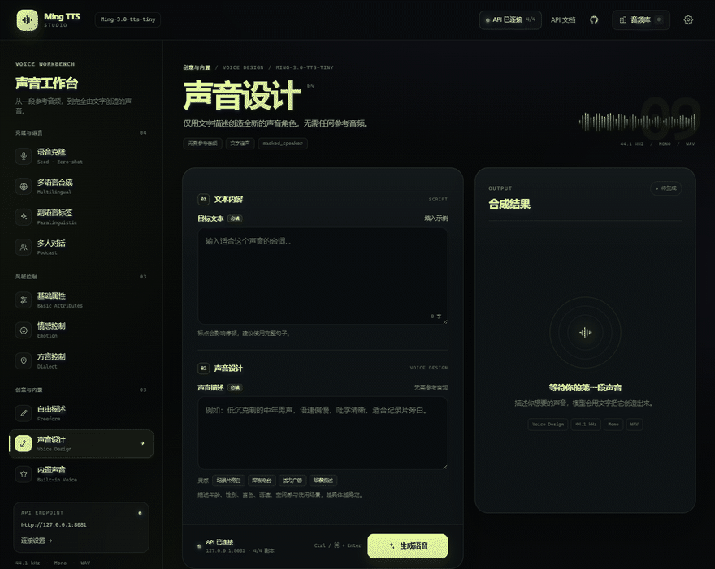
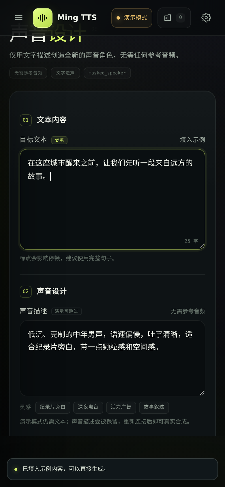
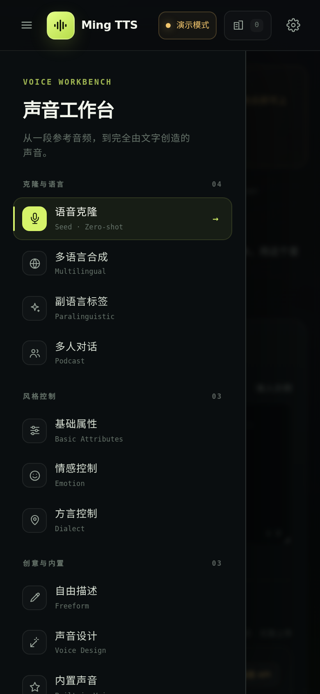

<div align="center">


# Ming TTS Studio

**Ming-3.0-tts 的开源 Web 声音工作台**

**A self-hosted web UI for Ming-3.0-tts — voice cloning, voice design, podcast.**

语音克隆 · 多语言 · 副语言 · 多人播客 · 基础属性 · 情感 · 方言 · 自由描述 · 声音设计 · 内置声音

[](https://github.com/inclusionAI/Ming-3.0-tts)
[](LICENSE)
[](#完整自托管含后端)
[](#项目结构)
[](#浏览器支持)

[官方项目](https://github.com/inclusionAI/Ming-3.0-tts) · [Hugging Face](https://huggingface.co/inclusionAI/Ming-3.0-tts-tiny) · [ModelScope](https://www.modelscope.cn/models/inclusionAI/Ming-3.0-tts-tiny) · [作者](https://github.com/AiFLYF)

</div>



> **非官方 Web 界面，与模型作者无隶属关系。** 仓库里既有纯静态前端，也有可选的 FastAPI 推理后端（单卡到四卡、最少在途调度）。想只看界面，`python3 -m http.server` 就够；想真正出声，`./start.sh` 一条命令拉起网关与全部 worker。没有后端时页面自动进入演示模式，整套界面照样走得完。

## 为什么还需要一个前端

官方仓库提供的是推理代码、CLI 和 Python API——**没有网页界面**（仓库里的 `frontend/` 是 TTS 文本前端，负责数字与符号的正则化，不是 UI）。所以每次想试一个音色，都得改命令行参数、等文件落盘、再用播放器打开。

这个项目把那 10 个任务做成了表单：

- **看得见参数**：每个任务有独立的字段、提示、示例和校验，不像把请求字段一股脑堆进一个 JSON 框。
- **听得见参考**：上传的音频能直接在页面里试听，确认是想要的那一段再提交。
- **改得动结果**：波形可视化、点击跳转、一键下载 WAV，失败时显示服务端返回的真实错误。
- **开箱能跑**：前端纯静态，`python3 -m http.server` 就能开；后端 `./start.sh` 自动下载权重、按 GPU 数量拉起 worker，再挂上门户。没 GPU 时前端照常用（演示模式）。

适合做短视频配音、有声书、播客对谈、游戏 NPC 台词、方言内容，以及需要在内网自部署 TTS 的团队。

<details>
<summary>目录</summary>

- [为什么还需要一个前端](#为什么还需要一个前端)
- [官方资源](#官方资源)
- [30 秒上手](#30-秒上手) · [完整自托管（含后端）](#完整自托管含后端)
- [功能特性](#功能特性) · [任务矩阵](#任务矩阵)
- [接入 API](#接入-api) · [配置优先级](#配置优先级) · [跨域要求](#跨域要求)
- [API 约定](#api-约定) · [任务请求字段](#任务请求字段)
- [常见问题](#常见问题)
- [部署](#部署) · [项目结构](#项目结构) · [自定义](#自定义) · [浏览器支持](#浏览器支持)
- [English](#english) · [致谢与许可](#致谢与许可)

</details>

## 官方资源

| 资源 | 地址 |
| --- | --- |
| 官方项目（推理代码、cookbook、评测） | [inclusionAI/Ming-3.0-tts](https://github.com/inclusionAI/Ming-3.0-tts) |
| 模型权重 · Hugging Face | [inclusionAI/Ming-3.0-tts-tiny](https://huggingface.co/inclusionAI/Ming-3.0-tts-tiny) |
| 模型权重 · ModelScope（国内下载更快） | [inclusionAI/Ming-3.0-tts-tiny](https://www.modelscope.cn/models/inclusionAI/Ming-3.0-tts-tiny) |
| 轻量版 0.5B | [Hugging Face](https://huggingface.co/inclusionAI/Ming-3.0-tts-0.5b) · [ModelScope](https://www.modelscope.cn/models/inclusionAI/Ming-3.0-tts-0.5b) |
| 在线体验（官方平台） | [ling.tbox.cn](https://ling.tbox.cn) |
| 组织主页 | [github.com/inclusionAI](https://github.com/inclusionAI) |

下载权重（国内建议走 ModelScope）：

```bash
pip install modelscope
modelscope download --model inclusionAI/Ming-3.0-tts-tiny --local_dir Ming-3.0-tts-tiny

# 或 Hugging Face
pip install "huggingface_hub[cli]"
hf download inclusionAI/Ming-3.0-tts-tiny --local-dir Ming-3.0-tts-tiny
```

> 多说话人（播客）任务只有 `tiny` 支持。本仓库自带的推理后端也**只支持 tiny**（`server/ming_tiny` 与官方 0.5b 的 tokenizer、prompt 布局不通用）；想跑 0.5B 要另接官方 0.5b 推理栈，前端本身不挑模型。

## 30 秒上手

### 只看界面（不需要 GPU、不需要模型）

前端是纯静态站点，不需要 npm、打包器或构建步骤：

```bash
git clone https://github.com/AiFLYF/ming-tts-studio.git
cd ming-tts-studio
python3 -m http.server 8082
```

打开 <http://127.0.0.1:8082>。页面会以演示模式启动，内置示例音频，所有任务与交互都能走通。

### 连接已有的网关

如果已经有一个兼容的 Ming 服务（默认 `http://127.0.0.1:8081`），任选一种方式让页面连上：

1. 点击右上角的「演示模式」状态或齿轮按钮，填入 API 地址并保存；
2. 直接带参数打开：`http://127.0.0.1:8082/?api=http://127.0.0.1:8081`；
3. 写入 [`assets/js/config.js`](assets/js/config.js) 的 `apiBase`，作为所有访客的默认值。

连接成功后状态变为「API 已连接 · 4/4」，上传与真实合成随即可用。

### 完整自托管（含后端）

仓库自带 `server/`：FastAPI 网关 + 每卡一个 worker + 最少在途请求调度，**首次启动会自动从 ModelScope / Hugging Face 下载权重**。

```bash
# 1) 建环境（Python 3.10 + CUDA 11.8 的 torch，官方 tiny 版要求）
./scripts/setup_linux.sh          # Windows: powershell -ExecutionPolicy Bypass -File scripts\setup_windows.ps1

# 2) 起服务：自动下载模型 → 逐个拉起 worker → 预热 → 起网关
./start.sh                        # Windows: start.bat（无 .venv 时自动切到 WSL2）
```

跑完后：

| 地址 | 用途 |
| --- | --- |
| <http://127.0.0.1:8081/studio/> | 前端（由网关同源托管，无需另起静态服务） |
| <http://127.0.0.1:8081/health> | 健康检查与在线副本数 |
| <http://127.0.0.1:8081/cluster/status> | 每个 GPU / worker 的详细状态 |
| <http://127.0.0.1:8081/docs> | Swagger（由 worker 提供，经网关转发） |

常用参数：`./start.sh --gpus 0,1`、`--no-warmup`、`--dry-run`（只打印部署计划）、`--skip-model-download`；`./status.sh` 看状态，`./stop.sh` 停全部。配置项都在 [`.env.example`](.env.example) 里，复制成 `.env` 即可生效。

> 默认要求每张卡至少 `MIN_FREE_VRAM_MB=19000` 空闲显存；不满足时启动器会直接报错退出，不会跑到一半 OOM。

## 功能特性

- **全部 10 项官方任务**：语音克隆、多语言、副语言标签、多人播客、基础属性、情感、方言、自由描述、声音设计、内置声音。每个任务都有独立表单、提示、示例与参数校验。
- **7 种目标语言**：中文、英语、日语、韩语、德语、法语、西班牙语。语音克隆与多语言合成这两个任务都开放全部 7 种——官方按语言把它们拆成 `seed` 与 `multilingual` 两个 id，但条件方式完全相同，界面按所选语言自动提交对应的那个。
- **14 种内联标签**：呼吸、咳嗽、叹息、笑声、犹豫，以及惊讶 / 不满 / 确认 / 疑问四种语气下的多种写法（共 14 个），一键插入文本，悬停有中文说明。标签区分大小写、必须带方括号。
- **官方全量音色表**：117 个内置音色（50 个纯音色 + 62 个带情绪变体 + 5 个英文），合计 484 个可选声音。带变体的音色要在界面上再选一次情绪，前端自动拼成 `灵信远_高兴` 这样的完整标识——官方明确要求不能只传基名。
- **真实的上传闭环**：拖拽或选择 WAV / MP3 / FLAC，显示时长、采样率与大小；服务端音频库支持搜索、复用和二次确认删除。参考音频以波形展示，可拖动两端手柄框选实际参与合成的片段（0.5–30 秒），试听只播放选区并与提交给模型的区间完全一致。
- **会自己兜底的演示模式**：API 不可达时自动切换为内置示例音频，界面仍可完整走通；连接恢复后一键回到在线模式。
- **清晰的合成结果**：波形可视化、播放 / 暂停、点击跳转、下载 WAV，并展示时长、采样率、任务与总耗时。
- **连接状态可见**：启动即检测 `/health`，展示在线副本数；设置弹窗内置连接测试、延迟和副本状态。
- **深度链接与键盘操作**：`#seed`、`#podcast`、`#voice_design` 等哈希直接打开对应任务；`Ctrl / ⌘ + Enter` 生成，`Esc` 关闭弹窗。
- **可安装、可离线**：Service Worker 只缓存同源静态外壳，断网时页面照常打开、演示模式仍可用；API 请求永不缓存。
- **为分享而生的界面**：暗色工作台视觉、响应式抽屉导航、焦点陷阱、减少动态效果偏好支持，可直接托管在 GitHub Pages。

| 移动端 | 任务抽屉 |
| --- | --- |
|  |  |

## 任务矩阵

| # | 界面名称 | 英文 | 参考音频 | 适合场景 |
| --- | --- | --- | --- | --- |
| 01 | 语音克隆 | Seed · Zero-shot | 必需 | 复刻音色、任意文本朗读 |
| 02 | 多语言合成 | Multilingual | 必需 | 同一音色跨语言 |
| 03 | 副语言标签 | Paralinguistic | 必需 | 14 种内联标签：呼吸、咳嗽、叹息、笑声、犹豫、惊讶、不满、确认、疑问 |
| 04 | 多人对话 | Podcast | 2–4 份 | 双人 / 多人播客 |
| 05 | 基础属性 | Basic Attributes | 必需 | 语速、音调、音量微调 |
| 06 | 情感控制 | Emotion | 必需 | 七种情绪表达 |
| 07 | 方言控制 | Dialect | 必需 | 川渝话、广粤话 |
| 08 | 自由描述 | Freeform | 可选 | 用文字指导表演；带参考音频则克隆音色 |
| 09 | 声音设计 | Voice Design | 不需要 | 从描述创造全新音色 |
| 10 | 内置声音 | Built-in Voice | 不需要 | 快速使用官方配音员 |

> 语言：7 种（中文、英语、日语、韩语、德语、法语、西班牙语）。官方把语音克隆限定在中文/英语、多语言合成限定在其余五种；界面把 7 种都放在 01 和 02 下，按语言自动切换底层 `task`。

## 接入 API

前端只需要一个兼容以下接口的 HTTP 服务。**任何实现了这套约定的服务都可以直接接入**，不限于官方实现。

完整参考（字段取值、别名、错误码、curl / JS / Python 示例、HTTPS 页面连 http 网关的做法）在 **[docs/API.md](docs/API.md)**；网关跑起来后，`http://<host>:8081/docs` 还有一份交互式 OpenAPI。

| 方法 | 路径 | 用途 |
| --- | --- | --- |
| `GET` | `/health` | 连接检测、在线副本数、模型状态 |
| `POST` | `/generate` | 提交合成参数，返回 `audio/wav` 二进制 |
| `POST` | `/upload` | `multipart/form-data` 上传参考音频 |
| `GET` | `/uploads` | 音频库列表 |
| `DELETE` | `/uploads/{filename}` | 删除已上传音频 |
| `GET` | `/uploads/{filename}` | 浏览器试听（服务端静态文件） |

`/health` 示例：

```json
{
  "status": "healthy",
  "model_loaded": true,
  "workers_available": 4,
  "workers_total": 4,
  "requests_in_flight": 0
}
```

> 前端靠这个响应判断"连上的是不是 Ming"。只要出现 `model_loaded`、`workers_available`、`workers_total`、`requests_in_flight` 中任意一个即可；只有 `status` 时，取值必须是 `healthy` / `degraded` / `loading` / `offline` / `unhealthy` 之一。反向代理常见的 `{"status":"ok"}` 会被判定为"该地址不是 Ming TTS API"，从而留在演示模式。

### 配置优先级

页面按以下顺序决定 API 地址：

| 优先级 | 来源 | 说明 |
| --- | --- | --- |
| 1 | URL 参数 `?api=http://host:port` | 仅对当前页面生效，不写入存储 |
| 2 | 浏览器 `localStorage` | 设置弹窗保存的地址，键名 `ming-tts-studio:api-base` |
| 3 | `assets/js/config.js` → `apiBase` | 站点默认值 |
| 4 | 自动推断 | HTTP(S) 页面使用同源；`file://` 直开时使用 `http://127.0.0.1:8081` |

### 跨域要求

前端通常与推理服务不同源，服务端必须允许跨域，并暴露音频元数据响应头。FastAPI 参考配置：

```python
from fastapi.middleware.cors import CORSMiddleware

app.add_middleware(
    CORSMiddleware,
    allow_origins=["*"],          # 生产环境建议收窄为站点域名
    allow_credentials=False,
    allow_methods=["*"],
    allow_headers=["*"],
    expose_headers=["X-Duration", "X-Sample-Rate", "X-Task"],
)
```

- 没有 `Access-Control-Allow-Origin`，浏览器会直接报 `Failed to fetch`。
- 没有 `Access-Control-Expose-Headers`，前端读不到 `X-Duration` 等响应头；页面会退回解析 WAV 头，但 MP3 / FLAC 无法读取时长。
- 若使用网关闭环转发，记得移除上游返回的 CORS 头，避免重复响应头。

### CORS 之外

- 页面通过 HTTPS 托管时，API 也必须是 HTTPS，否则浏览器会拦截混合内容。
- `/generate` 超时时间为 5 分钟，够单卡生成长文本；本后端**没有纯 CPU 路径**（启动器先查 `nvidia-smi`，worker 固定 `DEVICE=cuda:0`）。
- 上传接口限制 50 MB，前端会先做格式与大小检查；网关侧请求体上限 55 MB，超限直接 413，不会先收完再判断。

### 访问密码（可选）

在 `.env` 里设置 `STUDIO_PASSWORD=你的密码`，重启服务（`./stop.sh && ./start.sh`）即可开启：

- 浏览器访问 `/studio/` 会先进入登录页；通过后写入 HttpOnly 会话 Cookie，默认有效 24 小时（可用 `STUDIO_SESSION_HOURS` 调整）。
- 保护范围包括页面、静态资源、`/generate`、上传与音频库等全部 API；`/health` 保持公开，方便探活和监控。
- 脚本可用 HTTP Basic（用户名任意）：`curl -u studio:你的密码 http://127.0.0.1:8081/cluster/status`。访问 `/logout` 可退出登录。
- `STUDIO_PASSWORD` 留空或不写时完全关闭，行为与之前一致。
- 密码明文保存在 `.env`，HTTP 传输也不是加密的；公网部署请在前面套 HTTPS 反向代理。

### 安全与网络暴露

`./start.sh` 启动的网关默认监听 `0.0.0.0:8081`。内置密码门可以挡住未授权访问，但**没有速率限制**；如果要放到公网：

- 最省事的做法是套一层带认证的反向代理（Nginx basic auth、Cloudflare Access、Authelia 都行），只把 `/studio/` 与 API 暴露出去；
- 不要把仓库根目录整个交给静态服务器——`server/`、`uploads/`、`.env` 都不该被公网读到（Pages 工作流已经只发布前端文件）。
- 单 worker 内推理是**串行**的（模型不可重入），并发请求会在 worker 内排队；要吞吐就加卡，网关会按最少在途请求分摊。

## API 约定

### 上传参考音频

```bash
curl -F "file=@reference.wav" http://127.0.0.1:8081/upload
```

```json
{
  "filename": "a1b2c3d4e5_reference.wav",
  "url": "/uploads/a1b2c3d4e5_reference.wav",
  "path": "/uploads/a1b2c3d4e5_reference.wav",
  "size": 1072592,
  "size_kb": 1047.5,
  "uploaded_at": "2026-10-23T10:54:49",
  "original_name": "reference.wav",
  "duration": 6.08,
  "sample_rate": 44100,
  "channels": 1,
  "message": "文件 'reference.wav' 上传成功"
}
```

前端会把 `url` 原样作为 `prompt_wav` 提交给 `/generate`。**两个字段都是 URL，不是服务器文件路径**——页面不需要、也不会知道服务端把文件存在哪。后端会把任何引用折叠成文件名并限制在上传目录内，所以传 `path`、`url` 或裸文件名都可以，传绝对路径反而会被拒绝。

### 生成语音

以语音克隆为例：

```bash
curl -X POST http://127.0.0.1:8081/generate \
  -H "Content-Type: application/json" \
  -d '{
    "task": "seed",
    "text": "深夜十一点，城市终于安静下来。",
    "prompt_wav": "/uploads/a1b2c3d4e5_reference.wav",
    "prompt_text": "参考音频中真实说出的文本",
    "target_language": "Chinese"
  }' \
  -D headers.txt \
  -o speech.wav
```

响应为 `audio/wav`，并附带：

```text
X-Duration: 9.92
X-Sample-Rate: 44100
X-Task: seed
```

失败时返回 JSON `{"detail": "..."}`，前端会将其显示为错误提示。

### 任务请求字段

请求体字段与官方 Python API 一一对应（`task`、`text`、`prompt_wav`、`prompt_text`、`target_language`），网关只需做薄转发。

取值同时接受官方短码与中文（后端会归一化）：`target_language` 可用 `Japanese` 或 `ja`；`dialect` 可用 `川渝话` / `广粤话` / `cantonese` / `chuanyu dialect` / `四川话` / `粤语`；`emotion` 可用 `高兴` 或 `happy`。

| 任务 | `task` | 必填字段 | 关键参数 |
| --- | --- | --- | --- |
| 语音克隆 | `seed` | `text`、`prompt_wav`、`prompt_text`、`target_language` | `target_language`：`Chinese` / `English` |
| 多语言合成 | `multilingual` | `text`、`prompt_wav`、`prompt_text`、`target_language` | 日语 / 韩语 / 德语 / 法语 / 西班牙语 |
| 副语言标签 | `paralinguistic` | `text`、`prompt_wav`、`prompt_text`、`target_language` | 14 种内联标签，如 `[Sigh]`、`[Question-huh]` |
| 多人对话 | `podcast` | `text`、`prompt_wav[]`、`prompt_text[]` | 至少 2 位说话人，脚本行以 `speaker_1:` 开头 |
| 基础属性 | `basic` | `text`、`prompt_wav` | `speed`、`pitch`、`volume` |
| 情感控制 | `emotion` | `text`、`prompt_wav`、`emotion` | 中性 / 悲伤 / 愤怒 / 高兴 / 惊讶 / 恐惧 / 厌恶 |
| 方言控制 | `dialect` | `text`、`prompt_wav`、`dialect` | `川渝话` / `广粤话` |
| 自由描述 | `freeform` | `text`、`instruction` | 参考音频可选（传了就克隆该音色），用自然语言描述表演方式 |
| 声音设计 | `voice_design` | `text`、`style` | 无需参考音频，用文字创造新音色 |
| 内置声音 | `ip` | `text`、`ip` | 选择官方配音员，无需参考音频 |

> 表中的「必填」对应界面的校验规则。部分后端对 `basic` / `emotion` / `dialect` 的参考音频允许省略，但本界面为了输出稳定会要求上传。

> `seed` 与 `multilingual` 的官方语言白名单是分开的（前者中文/英语，后者其余五种），但两者条件方式完全相同（一段参考音频 + 对应文本）。界面把 7 种语言都放在这两个任务下，提交时按语言自动选 `task`；直接调 API 时仍按官方白名单校验，送错语言会得到 400。

## 常见问题

**没有 GPU、也没下载模型，能先看看界面吗？**
能。直接 `python3 -m http.server` 打开就是演示模式：所有表单、上传之外的操作、播放器和波形都能走通，音频用的是仓库里的示例。

**为什么一定要填「参考文本」？**
官方模型要求 `prompt_text` 与参考音频里**实际说出的内容逐字一致**。填错或偷懒复制一段别的文本，音色相似度会明显下降。这也是最常见的效果翻车原因。

**提示 `Failed to fetch` 怎么排查？**
按顺序看三件事：① 后端是否在跑（`curl http://host:port/health`）；② 服务端有没有返回 `Access-Control-Allow-Origin`；③ 页面是 HTTPS 而 API 是 HTTP 时，浏览器会直接拦截混合内容。

**状态一直显示「演示模式」，但服务明明开着？**
多半是 `/health` 的返回不被识别。前端只认 Ming 的字段（见上文 `/health` 示例）；如果返回的是 `{"status":"ok"}` 这类通用健康检查，会被判为"不是 Ming TTS API"。

**为什么选了音色还要再选一次情绪？**
官方音色表里 62 个声音只提供带情绪后缀的标识（`灵信远_高兴`、`灵信远_生气`……），传基名会被模型拒绝。界面因此把它们做成"音色 + 情绪"两级选择；其余 55 个音色没有变体，直接传名字。

**0.5B 模型能用这个界面吗？**
不能直接换。本仓库自带的 `server/` 是 tiny 专用栈（`worker.py` 里 `from ming_tiny import MingTinyTTS` 是写死的，且要求 `transformers==4.46.3`），下载 0.5B 权重也会在加载阶段失败。用 0.5B 需要另起一个官方 0.5b 推理服务，再让前端指过去——界面只认那 6 个接口，不认模型。

**生成的音频存在哪里？**
合成结果在浏览器内存里（`Blob`），关掉页面就没了，需要保存请点「下载 WAV」。参考音频则存在服务端 `/uploads`，可以在音频库里复用或删除。

**刷新之后还是旧界面？**
Service Worker 缓存了静态资源。升级时改代码的人需要同步三处版本号（见 [自定义](#自定义)）；普通用户按 `Ctrl / ⌘ + Shift + R` 强制刷新即可。

**能部署到公网吗？**
能，但 API 必须也是 HTTPS，且 CORS 要放行站点域名。内网 API 无法被公网浏览器访问，需要反向代理或安全隧道。

**可以用自己的 TTS 后端吗？**
可以。只要实现上面 6 个接口即可，前端不关心你用的是官方实现、vLLM-Omni、还是别的推理服务。

**跑后端需要什么硬件？**
NVIDIA GPU + 驱动 525 以上，Python 必须是 3.10（官方 tiny 版锁定 torch 2.7.1 + CUDA 11.8）。启动器默认每张卡要求 `MIN_FREE_VRAM_MB=19000` 空闲显存，不够会直接退出而不是跑到一半 OOM；单卡也能跑，`./start.sh --gpus 0` 即可。

**权重下到哪、占多大？**
默认 `models/Ming-3.0-tts-tiny`，由 `server/download_model.py` 从 ModelScope 或 Hugging Face 拉取（`.env` 里 `MODEL_SOURCE` 可以强制其中一边，国内建议 ModelScope）。权重不会进仓库，`.gitignore` 已排除。

**GitHub Pages 上能真实合成吗？**
不能。Pages 只托管静态文件，浏览器需要一个可访问的 API。用 Pages 看看界面和演示模式可以；要真出声，就在有 GPU 的机器上 `./start.sh`，然后从 Pages 页面填那台机器的地址（或直接用 `/studio/` 同源访问）。

**`./start.sh` 报 "GPU 0 has only … MiB free" 怎么办？**
先把占用显存的进程清掉，或者调低 `.env` 里的 `MIN_FREE_VRAM_MB`（tiny 版单卡实际占用接近 20 GB，压太低会 OOM）。只想看部署计划不启动服务，加 `--dry-run`（不会下载权重）。

**克隆真人声音需要注意什么？**
官方 README 明确要求：克隆真实人物声音须取得授权，合成语音在可能被误认为真实录音的场景下应明确标注。

## 部署

前端只有两个落点：**GitHub Pages**（公网展示，后端另接）或**与网关同源**（自托管一体化）。本地开个静态服务看界面的命令见 [30 秒上手](#30-秒上手)；后端部署细节见 [Linux / WSL2](docs/DEPLOY_LINUX.md) · [Windows](docs/DEPLOY_WINDOWS.md)。

### GitHub Pages

仓库已含 [`.github/workflows/pages.yml`](.github/workflows/pages.yml)，推到 `main` 就发布，不需要构建。**首次**只需启用一次：

1. **Settings → Pages → Source** 选 **GitHub Actions**（不要选分支）；
2. 等 `Deploy static site to Pages` 跑绿。

> 顺序有讲究：Pages 没启用就先推送，`configure-pages` 会在 Configure 步骤直接报 `Get Pages site failed ... Not Found`，10 秒失败；启用后重跑一次即可。

页面纯静态、路径全相对，可以住在子路径下（如 `https://aiflyf.github.io/ming-tts-studio/`），`.nojekyll` 已包含。工作流只把 `index.html`、`sw.js`、`assets`、`screenshots`、`site.webmanifest`、`.nojekyll` 放进 `_site`，`server/`、`models/`、`uploads/`、`.env` 不会上网。

**改仓库名或绑自定义域名**时，`index.html` 里 5 处绝对地址要一起换：`og:url`、`og:image`、`twitter:image`，以及结构化数据里的 `url` 与 `screenshot`。社交平台不会解析相对的 `og:image`。

页面要连自己的后端还有两条硬约束：API 必须是 HTTPS（否则被浏览器按混合内容拦掉），内网地址公网浏览器也够不着（要反代或隧道）。跨域细节见 [跨域要求](#跨域要求)，暴露面见 [安全与网络暴露](#安全与网络暴露)。

### 从 HTTPS 页面连 http:// 网关

GitHub Pages 是 HTTPS，浏览器默认禁止它请求 `http://` 地址（混合内容拦截），表现是「连接 API 一直转圈，最后 Failed to fetch」。两种办法：

1. **直接打开网关自带的页面** `http://<网关IP>:8081/studio/` —— 同源，零设置，推荐；
2. **继续用 Pages**：点地址栏左侧图标 → **网站设置** → 把「**不安全内容**」设为「**允许**」→ 刷新本页，再填地址。允许后可以直连。

局域网 IP 还要过 Chrome 的 Private Network Access 预检，网关与 worker 都会回 `Access-Control-Allow-Private-Network: true`。界面检测到被拦时会直接把这两个办法写在错误提示里。

### 与网关同源托管

`./start.sh` 已经这么做：网关把 `index.html`、`assets/`、`sw.js`、`site.webmanifest` 挂在 `/studio/`，其余路径不对外；上传目录仅以 `/uploads/<文件名>` 只读公开。

自己实现时最小只需两步，同源场景不需要 CORS：

```python
app.mount("/studio/assets", StaticFiles(directory="ming-tts-studio/assets"), name="studio-assets")
# 再加 GET /studio/ -> FileResponse("ming-tts-studio/index.html")
```

前端默认 API 地址会自动指向页面源。

## 项目结构

```text
ming-tts-studio/
├── index.html                  # 语义化页面骨架、弹窗与脚本入口
├── sw.js                       # Service Worker：同源静态外壳离线缓存
├── assets/
│   ├── css/app.css             # 设计系统、组件、响应式与动效
│   ├── js/
│   │   ├── config.js           # 运行时配置（API、版本号、轮询间隔）
│   │   ├── data.js             # 10 项任务的文案、字段、示例与音色表
│   │   ├── api.js              # TTSClient、上传、WAV 元数据解析
│   │   └── app.js              # 路由、表单、播放器、音频库、设置
│   ├── audio/demo-zh.wav       # 内置演示音频（模型生成）
│   └── img/                    # favicon.svg、192/512/maskable 与 apple-touch 图标
├── server/
│   ├── launcher.py             # 一键启动：查 GPU、下权重、拉 worker、预热、起网关
│   ├── gateway.py              # 网关：最少在途调度、CORS、/studio 同源托管、健康汇总
│   ├── auth.py                 # 可选访问密码：登录页、HttpOnly 会话 Cookie、Basic

│   ├── worker.py               # 单卡推理服务：10 个任务的参数校验与 /generate
│   ├── download_model.py       # ModelScope / Hugging Face 下载与完整性检查
│   ├── ming_tiny/              # 上游推理包（见 THIRD_PARTY_NOTICES.md）
│   └── requirements-*.txt      # 固定版本的运行时依赖
├── scripts/setup_linux.sh · setup_windows.ps1
├── start.sh · stop.sh · status.sh   # 及对应 .bat（Windows 无 .venv 时走 WSL2）
├── docs/DEPLOY_LINUX.md · DEPLOY_WINDOWS.md · API.md
├── screenshots/                # README 展示图与操作动图
├── .github/workflows/pages.yml
├── site.webmanifest · .nojekyll · .env.example
├── THIRD_PARTY_NOTICES.md
├── LICENSE
└── README.md
```

前端四层职责清晰到可以单独替换：`config.js`（运行时配置）→ `data.js`（任务元数据）→ `api.js`（HTTP 客户端与 WAV 解析）→ `app.js`（视图与交互）。新增一个任务通常只需要往 `data.js` 的 `TASKS` 里加一项。

```text
浏览器
  │  GET  /studio/            → 网关直接返回 index.html（同源，免 CORS）
  │  POST /generate + JSON    → 网关按"最少在途"挑一个 worker
  │  POST /upload + multipart → 任一 worker，文件落在共享 uploads/
  ▼
gateway.py :8081   ← launcher.py 按 GPU 数量拉起，健康状态汇总在 /health
  ├── worker.py :8091 · GPU 0 ─┐
  ├── worker.py :8092 · GPU 1 ─┤  ming_tiny 推理包，每进程独占一张卡
  ├── worker.py :8093 · GPU 2 ─┤  CUDA_VISIBLE_DEVICES 由启动器注入
  └── worker.py :8094 · GPU 3 ─┘
        │
        └── uploads/  共享参考音频（网关与所有 worker 同一个目录）
```

网关会把上游返回的 CORS 头剥掉再自己发，避免重复响应头；请求体上限 55 MB，流式转发不落盘。任何实现同一套接口约定的服务都能替换掉这个后端。

## 自定义

- **主题**：修改 [`assets/css/app.css`](assets/css/app.css) 顶部 `:root` 中的颜色、圆角、字体与布局变量。
- **任务与示例**：修改 [`assets/js/data.js`](assets/js/data.js) 的 `TASKS`、`VOICE_GROUPS`、`EMOTIONS` 与语言映射。
- **运行时配置**：[`assets/js/config.js`](assets/js/config.js)
  - `apiBase`：默认 API 地址；
  - `demoAudio`：内置演示音频路径；
  - `healthIntervalMs`：健康检查轮询间隔（默认 20 秒）。
- **演示音频**：替换 `assets/audio/demo-zh.wav`，建议使用 44.1 kHz 单声道 WAV；文件路径不变时无需改代码。
- **版本号与缓存**：改完样式或脚本后，三处版本号要一起改，否则浏览器与 Service Worker 会继续用旧文件：
  - `assets/js/config.js` → `version`（页脚显示）；
  - `index.html` → `app.css` 与 4 个 `<script>` 的 `?v=`；
  - `sw.js` → `VERSION`（旧版本缓存会在激活时自动清掉）。
- **离线缓存开关**：`assets/js/config.js` 里设 `serviceWorker: false` 即完全不注册 Service Worker；已注册过的浏览器需要清除站点数据才会移除。
- **品牌信息**：`index.html` 中的标题、描述、品牌字样与页脚。

修改后直接刷新页面即可；部署时无需构建。注意 Service Worker 会缓存静态资源——只改内容没改版本号时，浏览到的可能仍是旧文件，本地开发用 `Ctrl / ⌘ + Shift + R` 强制刷新即可绕过。

## 浏览器支持

- Chrome / Edge 100+
- Firefox 100+
- Safari 16+
- iOS Safari 16+ / Android Chrome 100+

使用原生 ES2020、Fetch、FormData、Canvas 与 Web Audio 相邻能力，无 polyfill。页面支持键盘导航、ARIA 标签、焦点管理，并尊重 `prefers-reduced-motion`。

可安装为 PWA：Chrome / Edge / Android Chrome 会提示"安装"，iOS Safari 通过「添加到主屏幕」。安装后离线也能打开界面并使用演示模式。

## English

**Ming TTS Studio** is an unofficial, self-hosted web UI for [Ming-3.0-tts](https://github.com/inclusionAI/Ming-3.0-tts) — Ant Group's open-source speech synthesis family (7.9B / 1.3B-active MoE, MIT license).

- **All 10 official tasks**: zero-shot voice cloning, multilingual synthesis across 7 target languages, 14 paralinguistic tags, multi-speaker podcast, speed/pitch/volume, 7 emotions, Sichuanese & Cantonese, freeform direction (reference clip optional), voice design, and 117 built-in voices (484 selectable variants).
- **Pure static front end**: no npm, no bundler, no framework, no build step. Serve the folder and open it.
- **Batteries-included backend**: `server/` ships a FastAPI gateway plus one worker per GPU with least-in-flight scheduling, model auto-download, warm-up and PID-based start/stop. One command brings the whole thing up.
- **Demo mode by default**: without a backend the whole interface still works against a bundled sample, so you can evaluate the UX before downloading a multi-GB checkpoint.
- **Backend-agnostic**: talks to any gateway implementing 6 HTTP endpoints. The request payload mirrors the official Python API (`task`, `text`, `prompt_wav`, `prompt_text`, `target_language`), so a thin FastAPI wrapper is usually enough.
- **Desktop and mobile**, installable as a PWA, offline-capable, keyboard accessible.

```bash
git clone https://github.com/AiFLYF/ming-tts-studio.git
cd ming-tts-studio && python3 -m http.server 8082   # front end only

./scripts/setup_linux.sh && ./start.sh              # full stack (needs NVIDIA GPU + Python 3.10)
```

Weights: [Hugging Face](https://huggingface.co/inclusionAI/Ming-3.0-tts-tiny) · [ModelScope](https://www.modelscope.cn/models/inclusionAI/Ming-3.0-tts-tiny)

## 致谢与许可

- 声音能力来自蚂蚁百灵（inclusionAI）开源的 **Ming-3.0-tts-tiny**：[项目仓库](https://github.com/inclusionAI/Ming-3.0-tts) · [Hugging Face](https://huggingface.co/inclusionAI/Ming-3.0-tts-tiny) · [ModelScope](https://www.modelscope.cn/models/inclusionAI/Ming-3.0-tts-tiny)。本仓库是非官方前端，模型与相关名称归其作者所有。
- `server/ming_tiny/` 的推理代码来自上游发布版本（改动见 [THIRD_PARTY_NOTICES.md](THIRD_PARTY_NOTICES.md)），权重不随仓库分发，运行时才下载。
- 内置演示音频由该模型生成，仅用于界面演示。
- 本项目代码以 [MIT License](LICENSE) 开源。

如果这个界面对你有帮助，欢迎 Star、提交 Issue 或 PR。作者：[AiFLYF](https://github.com/AiFLYF)。
